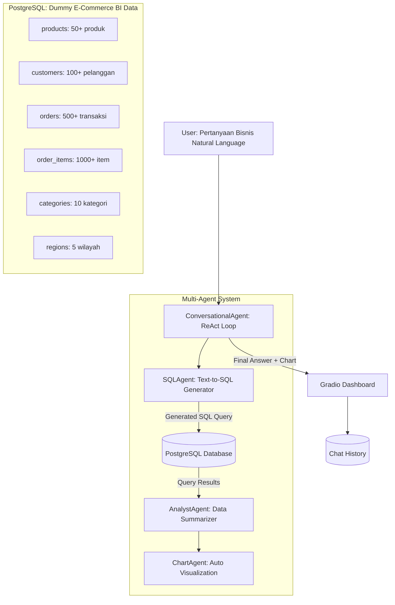

# 🧠 BizInsight AI — AI Business Intelligence Dashboard
## Natural Language → SQL → Analysis → Visualization

---

## 1. Ringkasan Project

**BizInsight AI** adalah dashboard Business Intelligence yang didukung LLM, di mana user bisa **bertanya dalam bahasa natural** (Bahasa Indonesia/Inggris) dan AI akan:

1. **Mengkonversi pertanyaan ke SQL query** (Text-to-SQL) secara otomatis
2. **Mengeksekusi query ke database PostgreSQL** yang berisi data bisnis
3. **Menganalisis & merangkum hasil** menggunakan LLM
4. **Menghasilkan chart/visualisasi otomatis** (bar, line, pie, dll)
5. **Menyimpan history chat** untuk konteks percakapan berkelanjutan

### Kenapa Project Ini Cocok untuk Belajar LLM + SQL Database?

| Aspek | Implementasi LLM |
|:---|:---|
| **Text-to-SQL** | LLM menganalisis schema DB lalu generate SQL query dari pertanyaan natural |
| **RAG dari Database** | Data real dari PostgreSQL dijadikan konteks untuk jawaban LLM |
| **Structured Output** | Pydantic models untuk validasi SQL result & chart config |
| **ReAct Tool Calling** | Agent memilih tools: `execute_sql`, `generate_chart`, `analyze_data` |
| **Multi-Agent** | SQLAgent, AnalystAgent, ChartAgent, ConversationalAgent |
| **Conversational Memory** | Chat history untuk follow-up questions |

---

## 2. Arsitektur Sistem



---

## 3. Database Schema (PostgreSQL — Dummy E-Commerce)

Kita akan membuat database dummy **toko online Indonesia** yang realistis dengan data yang cukup banyak untuk analisis BI yang menarik.

### Tabel-tabel:

```sql
-- 1. Kategori Produk
CREATE TABLE categories (
    id SERIAL PRIMARY KEY,
    name VARCHAR(100) NOT NULL,          -- 'Elektronik', 'Fashion', 'Makanan', dll
    description TEXT
);

-- 2. Wilayah / Region
CREATE TABLE regions (
    id SERIAL PRIMARY KEY,
    name VARCHAR(100) NOT NULL,          -- 'Jabodetabek', 'Jawa Barat', dll
    province VARCHAR(100)
);

-- 3. Produk
CREATE TABLE products (
    id SERIAL PRIMARY KEY,
    name VARCHAR(200) NOT NULL,
    category_id INTEGER REFERENCES categories(id),
    price DECIMAL(12,2) NOT NULL,        -- Harga dalam Rupiah
    cost DECIMAL(12,2) NOT NULL,         -- Harga modal
    stock INTEGER DEFAULT 0,
    created_at TIMESTAMP DEFAULT NOW()
);

-- 4. Pelanggan
CREATE TABLE customers (
    id SERIAL PRIMARY KEY,
    name VARCHAR(200) NOT NULL,
    email VARCHAR(200),
    region_id INTEGER REFERENCES regions(id),
    joined_at TIMESTAMP DEFAULT NOW()
);

-- 5. Pesanan / Orders
CREATE TABLE orders (
    id SERIAL PRIMARY KEY,
    customer_id INTEGER REFERENCES customers(id),
    order_date TIMESTAMP NOT NULL,
    status VARCHAR(50) DEFAULT 'completed',  -- completed, pending, cancelled
    total_amount DECIMAL(15,2),
    shipping_cost DECIMAL(12,2) DEFAULT 0
);

-- 6. Detail Pesanan
CREATE TABLE order_items (
    id SERIAL PRIMARY KEY,
    order_id INTEGER REFERENCES orders(id),
    product_id INTEGER REFERENCES products(id),
    quantity INTEGER NOT NULL,
    unit_price DECIMAL(12,2) NOT NULL,
    subtotal DECIMAL(15,2) NOT NULL
);
```

### Volume Data Dummy:
- **10** kategori produk (Elektronik, Fashion, Makanan & Minuman, Kecantikan, Olahraga, dll)
- **5** wilayah (Jabodetabek, Jawa Barat, Jawa Timur, Bali, Sumatera Utara)
- **50+** produk beragam dengan harga Rp 15.000 — Rp 15.000.000
- **100+** pelanggan
- **500+** orders tersebar di 12 bulan terakhir (untuk analisis tren)
- **1.000+** order items

---

## 4. Arsitektur Multi-Agent (Terinspirasi AutoBargain)

Mengadopsi pola-pola dari AutoBargain:

### Agent Hierarchy

| Agent | Terinspirasi Dari | Fungsi |
|:---|:---|:---|
| `BaseAgent` | [`agent.py`](file:///Users/timurdianradhasejati/Programming/Code/AI/autobargain_cars/agents/agent.py) | ANSI color logging, superclass |
| `SQLAgent` | [`frontier_agent.py`](file:///Users/timurdianradhasejati/Programming/Code/AI/autobargain_cars/agents/frontier_agent.py) | Text-to-SQL + execute query (mirip RAG tapi ke SQL) |
| `AnalystAgent` | [`preprocessor.py`](file:///Users/timurdianradhasejati/Programming/Code/AI/autobargain_cars/agents/preprocessor.py) | Merangkum & menganalisis data hasil query |
| `ChartAgent` | Baru | Menentukan tipe chart yang tepat & generate Plotly config |
| `ConversationalAgent` | [`conversational_agent.py`](file:///Users/timurdianradhasejati/Programming/Code/AI/autobargain_cars/agents/conversational_agent.py) | ReAct loop + tool calling + chat history |
| `PlanningAgent` | [`planning_agent.py`](file:///Users/timurdianradhasejati/Programming/Code/AI/autobargain_cars/agents/planning_agent.py) | Orchestrator pipeline |

### Pola yang Diadopsi dari AutoBargain:
1. **Multi-Model Failover** — fallback chain: `gemini-3.6-flash` → `groq/gpt-oss-120b` → `groq/gpt-oss-20b`
2. **ReAct Tool Calling Loop** — LLM memilih tools secara dinamis
3. **Pydantic Structured Output** — validasi ketat untuk SQL results & chart config
4. **ANSI Color Logging** — setiap agent punya warna unik di terminal
5. **Gradio Dashboard** — streaming logs + interactive UI

---

## 5. Pydantic Data Contracts

```python
class SQLQuery(BaseModel):
    """SQL query yang di-generate oleh LLM"""
    query: str          # SELECT ... FROM ...
    explanation: str    # Penjelasan apa yang di-query
    is_safe: bool       # True jika hanya SELECT (no INSERT/UPDATE/DELETE)

class QueryResult(BaseModel):
    """Hasil eksekusi SQL"""
    columns: List[str]
    rows: List[List[Any]]
    row_count: int
    execution_time_ms: float

class ChartConfig(BaseModel):
    """Konfigurasi chart yang di-generate LLM"""
    chart_type: str     # 'bar', 'line', 'pie', 'scatter', 'heatmap'
    title: str
    x_label: str
    y_label: str
    data_columns: List[str]

class BIInsight(BaseModel):
    """Insight bisnis hasil analisis LLM"""
    question: str       # Pertanyaan user
    sql_query: str      # SQL yang di-execute
    summary: str        # Rangkuman analisis dari LLM
    chart: Optional[ChartConfig]
    raw_data: QueryResult
```

---

## 6. Alur Kerja (Workflow)

```
User: "Berapa total revenue bulan ini per kategori?"
        │
        ▼
┌─ ConversationalAgent (ReAct Loop) ─────────────────────────┐
│                                                             │
│  1. LLM menerima pertanyaan + DB schema context             │
│  2. LLM memanggil tool `generate_sql`                       │
│     → SQLAgent menghasilkan:                                │
│       SELECT c.name, SUM(oi.subtotal) as revenue            │
│       FROM order_items oi                                   │
│       JOIN products p ON oi.product_id = p.id               │
│       JOIN categories c ON p.category_id = c.id             │
│       JOIN orders o ON oi.order_id = o.id                   │
│       WHERE o.order_date >= DATE_TRUNC('month', NOW())      │
│       GROUP BY c.name ORDER BY revenue DESC                 │
│                                                             │
│  3. LLM memanggil tool `execute_sql`                        │
│     → Query dieksekusi ke PostgreSQL → Dapat hasilnya       │
│                                                             │
│  4. LLM memanggil tool `generate_chart`                     │
│     → ChartAgent: "Bar chart cocok untuk perbandingan"      │
│     → Generate Plotly bar chart                             │
│                                                             │
│  5. LLM merangkum jawaban final:                            │
│     "Revenue bulan ini dipimpin oleh kategori Elektronik    │
│      sebesar Rp 45.2 Juta, diikuti Fashion Rp 32.1 Juta.   │
│      Total revenue: Rp 125.8 Juta (+12% vs bulan lalu)."   │
│                                                             │
└─────────────────────────────────────────────────────────────┘
        │
        ▼
   Gradio Dashboard: Jawaban + Chart + Tabel Data
```

---

## 7. Struktur Project

```
bizinsight_ai/
├── .env                          # API keys + DB connection string
├── requirements.txt              # Dependencies
├── seed_database.py              # Script generate dummy data ke PostgreSQL
├── db.py                         # Database connection & helper functions
├── app.py                        # Gradio Dashboard (main UI)
├── bi_agent_framework.py         # Framework orchestrator (mirip car_agent_framework.py)
├── agents/
│   ├── __init__.py
│   ├── agent.py                  # BaseAgent (ANSI logging)
│   ├── sql_agent.py              # Text-to-SQL generator + executor
│   ├── analyst_agent.py          # Data analysis & summarization
│   ├── chart_agent.py            # Auto chart type selection + Plotly generation
│   ├── conversational_agent.py   # ReAct tool calling conversational loop
│   └── models.py                 # Pydantic schemas (SQLQuery, QueryResult, dll)
└── README.md
```

---

## 8. Tech Stack

| Komponen | Teknologi |
|:---|:---|
| **Database** | PostgreSQL (via `psycopg2` / `asyncpg`) |
| **ORM/Query** | Raw SQL (agar LLM belajar generate SQL) |
| **LLM** | LiteLLM → Gemini 3.6 Flash / Groq GPT-OSS-120B (Free) |
| **Structured Output** | Pydantic v2 |
| **UI Dashboard** | Gradio + Plotly |
| **Visualization** | Plotly (bar, line, pie, scatter, heatmap) |
| **Environment** | Python 3.10+ |

---

## 9. Contoh Pertanyaan yang Bisa Dijawab

| Pertanyaan Natural Language | Jenis Analisis |
|:---|:---|
| "Berapa total revenue bulan ini?" | Agregasi sederhana |
| "Tampilkan 10 produk terlaris" | Ranking query |
| "Bandingkan penjualan Q1 vs Q2" | Perbandingan periode |
| "Wilayah mana yang paling banyak order?" | Analisis regional |
| "Tren penjualan 6 bulan terakhir" | Time series |
| "Produk apa yang marginnya paling tinggi?" | Profitability analysis |
| "Customer mana yang paling loyal?" | Customer analytics |
| "Kategori apa yang sedang naik/turun?" | Trend analysis |

---

## 10. Fitur Dashboard Gradio

1. **💬 Chat Interface** — Input pertanyaan natural language + streaming response
2. **📊 Auto Chart Panel** — Plotly chart yang di-generate otomatis sesuai data
3. **📋 Data Table** — Tabel hasil query yang bisa di-scroll
4. **🖥️ SQL Preview** — Menampilkan SQL query yang di-generate (untuk edukasi)
5. **📝 Agent Log Stream** — Real-time colored log dari setiap agent (mirip AutoBargain)
6. **📈 Quick Stats Cards** — Revenue, Orders, Customers, Top Product hari ini

---

## User Review Required

> [!IMPORTANT]
> **Pilihan Database**: Plan ini menggunakan **PostgreSQL**. Apakah kamu sudah punya PostgreSQL terinstall, atau mau saya bantu setup juga? Alternatif: bisa pakai **SQLite** dulu untuk development agar lebih mudah (tanpa perlu install server), lalu migrate ke PostgreSQL nanti.

> [!IMPORTANT]
> **Lokasi Project**: Project baru ini akan dibuat di folder baru `bizinsight_ai/` di samping folder `autobargain_cars/` yang sudah ada, yaitu di `/Users/timurdianradhasejati/Programming/Code/AI/bizinsight_ai/`. Setuju?

## Open Questions

1. **Database engine**: PostgreSQL langsung atau mulai dari SQLite dulu untuk kemudahan setup?
2. **Tema data dummy**: E-Commerce Indonesia sudah cocok, atau mau tema lain (restoran, sekolah, klinik)?
3. **API keys**: Apakah mau reuse API keys yang sama dari AutoBargain (Gemini, Groq), atau setup terpisah?
4. **Bahasa UI**: Dashboard dalam Bahasa Indonesia atau campuran ID/EN?

---

## Verification Plan

### Automated Tests
```bash
# 1. Seed database & verify data
python seed_database.py

# 2. Test koneksi DB
python db.py

# 3. Run full app
python app.py
```

### Manual Verification
- Ketik pertanyaan bisnis di chat → verifikasi SQL yang di-generate benar
- Verifikasi chart yang muncul sesuai dengan data
- Test berbagai jenis pertanyaan (agregasi, tren, ranking, perbandingan)
- Verifikasi agent logs muncul dengan warna yang benar
