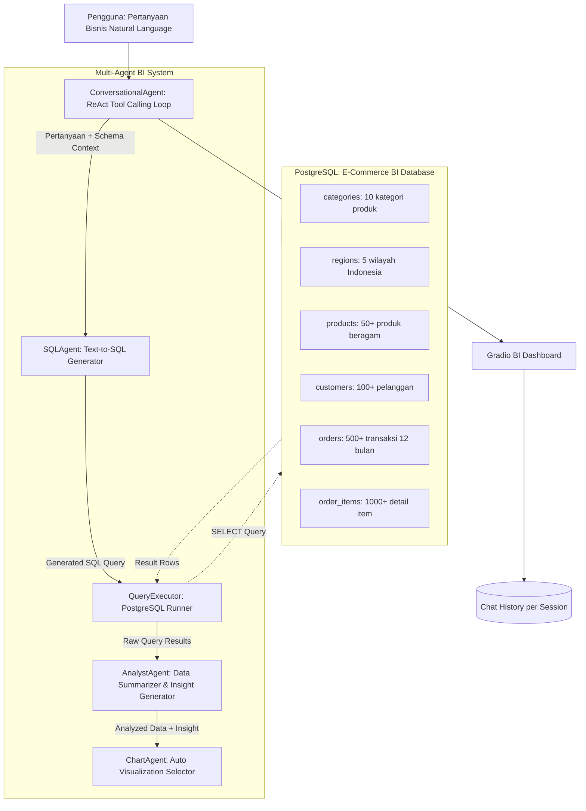
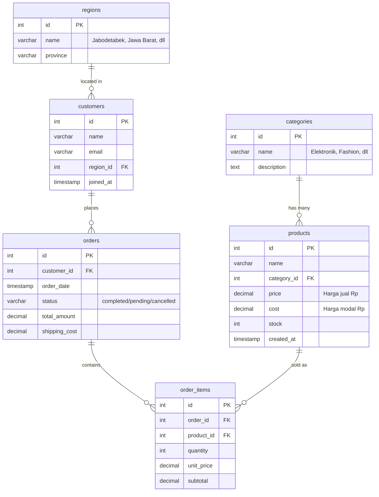

# 📑 Product Requirement Document (PRD)
# BizInsight AI — Autonomous Business Intelligence Multi-Agent System

---

## 1. Executive Summary & Vision
**BizInsight AI** adalah sistem Multi-Agent cerdas yang memungkinkan pengguna non-teknis untuk **menganalisis database bisnis menggunakan bahasa natural** tanpa perlu menulis SQL. Sistem ini secara otomatis:
1. Menerima pertanyaan bisnis dalam Bahasa Indonesia/Inggris dari pengguna.
2. Menganalisis schema database dan **mengonversi pertanyaan menjadi SQL query** menggunakan LLM (*Text-to-SQL*).
3. **Mengeksekusi query ke PostgreSQL** dan memvalidasi hasilnya dengan *Structured Outputs* Pydantic.
4. **Menganalisis & merangkum data** menjadi insight bisnis yang actionable menggunakan LLM.
5. **Menghasilkan visualisasi chart otomatis** (bar, line, pie, scatter, heatmap) menggunakan Plotly.
6. Menyajikan semua hasil dalam **dashboard interaktif berbasis Gradio** dengan chat interface, live chart, tabel data, dan SQL preview.

---

## 2. Core Architecture & Workflow Diagram



---

## 3. Data Contracts & Pydantic Schemas

### `SQLQuery`
Mewakili SQL query yang di-generate oleh LLM dari pertanyaan natural language.
- `query` (`str`): SQL query string yang valid (contoh: *"SELECT c.name, SUM(oi.subtotal) FROM ..."*).
- `explanation` (`str`): Penjelasan singkat apa yang dilakukan query ini dalam bahasa manusia.
- `is_safe` (`bool`): `True` jika query hanya berupa `SELECT` (bukan `INSERT`/`UPDATE`/`DELETE`/`DROP`).

### `QueryResult`
Mewakili hasil eksekusi SQL query ke database.
- `columns` (`List[str]`): Nama-nama kolom hasil query.
- `rows` (`List[List[Any]]`): Baris-baris data hasil query.
- `row_count` (`int`): Jumlah baris yang dikembalikan.
- `execution_time_ms` (`float`): Waktu eksekusi query dalam milidetik.

### `ChartConfig`
Konfigurasi visualisasi chart yang dipilih oleh LLM berdasarkan karakteristik data.
- `chart_type` (`str`): Tipe chart — `bar` / `line` / `pie` / `scatter` / `heatmap` / `none`.
- `title` (`str`): Judul chart yang deskriptif.
- `x_label` (`str`): Label sumbu X.
- `y_label` (`str`): Label sumbu Y.
- `x_column` (`str`): Nama kolom data untuk sumbu X.
- `y_columns` (`List[str]`): Nama kolom data untuk sumbu Y (bisa multi-series).

### `BIInsight`
Mewakili satu siklus lengkap tanya-jawab BI.
- `question` (`str`): Pertanyaan asli pengguna.
- `sql_query` (`str`): SQL query yang di-generate dan dieksekusi.
- `summary` (`str`): Rangkuman analisis dari LLM dalam bahasa natural.
- `chart` (`Optional[ChartConfig]`): Konfigurasi chart (bisa `None` jika tidak relevan).
- `raw_data` (`QueryResult`): Data mentah hasil query.

---

## 4. Database Schema — Dummy E-Commerce Indonesia

### Entity Relationship Diagram (ERD)



### Volume Data Dummy
| Tabel | Jumlah Record | Catatan |
|:---|:---|:---|
| `categories` | 10 | Elektronik, Fashion, Makanan & Minuman, Kecantikan, Olahraga, Otomotif, Rumah Tangga, Buku & Alat Tulis, Mainan & Hobi, Kesehatan |
| `regions` | 5 | Jabodetabek, Jawa Barat, Jawa Timur, Bali & NTB, Sumatera Utara |
| `products` | 50+ | Harga Rp 15.000 — Rp 15.000.000, beragam margin |
| `customers` | 100+ | Tersebar di 5 wilayah |
| `orders` | 500+ | Tersebar merata di 12 bulan terakhir, variasi status |
| `order_items` | 1.000+ | 1-5 item per order, variasi quantity |

### Distribusi Data untuk Analisis Menarik
- **Musiman**: Penjualan Elektronik naik di bulan November-Desember (Harbolnas/12.12).
- **Regional**: Jabodetabek mendominasi ~40% order, wilayah lain terdistribusi.
- **Tren**: Kategori Kecantikan menunjukkan pertumbuhan bulanan yang konsisten.
- **Anomali**: Beberapa produk premium memiliki margin sangat tinggi tetapi volume rendah.

---

## 5. Spesifikasi Modul Agen (`agents/`)

### 1. `BaseAgent` (`agents/agent.py`)
- **Tujuan**: Menyediakan fungsi logging thread-safe dengan kode warna ANSI terminal unik per agen.
- **Warna**: Cyan (SQL), Blue (Analyst), Magenta (Chart), Green (Conversational), Yellow (Planning).
- **Pola**: Identik dengan `BaseAgent` di AutoBargain AI.

### 2. `SQLAgent` (`agents/sql_agent.py`)
- **Tujuan**: Menerima pertanyaan natural language + database schema, lalu menghasilkan SQL query yang valid dan aman.
- **Model**: LiteLLM → Gemini 3.6 Flash / Groq GPT-OSS-120B / Groq GPT-OSS-20B.
- **Fitur Utama**:
  1. **Schema Injection**: Menyisipkan `CREATE TABLE` statements sebagai konteks agar LLM memahami struktur database.
  2. **Safety Guard**: Menolak query yang mengandung `INSERT`, `UPDATE`, `DELETE`, `DROP`, `ALTER`, `TRUNCATE`.
  3. **Query Execution**: Mengeksekusi SQL ke PostgreSQL menggunakan `psycopg2` dan mengembalikan `QueryResult`.
  4. **Error Recovery**: Jika SQL gagal dieksekusi, kirim error message kembali ke LLM untuk perbaikan (*self-healing*).
  5. **Multi-Model Failover**: Otomatis switch ke model cadangan jika model utama gagal/rate-limited.

### 3. `AnalystAgent` (`agents/analyst_agent.py`)
- **Tujuan**: Menerima `QueryResult` mentah dan merangkumnya menjadi insight bisnis yang mudah dipahami.
- **Model**: LiteLLM → Gemini 3.6 Flash / Groq.
- **Fitur Utama**:
  1. **Data Summarization**: Merangkum angka-angka kunci (total, rata-rata, min/max, tren).
  2. **Comparative Analysis**: Membandingkan antar-kategori, antar-periode, antar-wilayah.
  3. **Actionable Recommendations**: Memberikan saran bisnis berdasarkan data (misal: *"Tingkatkan stok Elektronik menjelang Harbolnas"*).
  4. **Bahasa Natural**: Output selalu dalam Bahasa Indonesia yang profesional dan ringkas.

### 4. `ChartAgent` (`agents/chart_agent.py`)
- **Tujuan**: Menentukan tipe visualisasi paling tepat berdasarkan karakteristik data, lalu menghasilkan Plotly figure.
- **Model**: LiteLLM (untuk memilih chart type) + Plotly (untuk rendering).
- **Logika Pemilihan Chart**:
  - **Bar Chart**: Perbandingan kategori (revenue per kategori, top 10 produk).
  - **Line Chart**: Tren waktu (penjualan bulanan, pertumbuhan customer).
  - **Pie Chart**: Proporsi/distribusi (share kategori, distribusi wilayah).
  - **Scatter Plot**: Korelasi 2 variabel (harga vs quantity, margin vs volume).
  - **Heatmap**: Matrix data (penjualan per kategori per bulan).
  - **None**: Jika data berupa single value atau tidak cocok divisualisasikan.

### 5. `ConversationalAgent` (`agents/conversational_agent.py`)
- **Tujuan**: Mengimplementasikan **ReAct Tool Calling Loop** sebagai orkestrator utama yang menerima pertanyaan user dan memanggil tools secara dinamis.
- **Model**: LiteLLM → Gemini 3.6 Flash / Groq GPT-OSS-120B.
- **Tools yang Tersedia**:
  - `query_database(question: str)` → Menerjemahkan pertanyaan ke SQL, eksekusi, dan kembalikan hasilnya.
  - `generate_chart(data: str, chart_hint: str)` → Membuat visualisasi Plotly dari data.
  - `analyze_data(data: str, context: str)` → Menganalisis data dan menghasilkan insight bisnis.
  - `get_schema_info()` → Mengembalikan informasi schema database untuk konteks.
- **Pola**: ReAct loop maksimal 4 iterasi tool-calling (identik dengan AutoBargain `ConversationalAgent`).
- **Chat History**: Menyimpan histori percakapan per `session_id` untuk konteks follow-up questions.

### 6. `BIAgentFramework` (`bi_agent_framework.py`)
- **Tujuan**: Framework orchestrator yang menginisialisasi semua agent, mengelola koneksi database, dan menyediakan entry point tunggal.
- **Pola**: Identik dengan `CarAgentFramework` di AutoBargain.
- **Tanggung Jawab**:
  1. Inisialisasi koneksi PostgreSQL.
  2. Membuat instance semua agent.
  3. Menyediakan method `ask(question)` sebagai entry point utama.
  4. Mengelola chat session history.

---

## 6. Antarmuka Pengguna & Dashboard (`app.py`)
- **Framework**: Gradio Web UI + Plotly Charts.
- **Fitur Utama**:

### Tab 1: 💬 AI Business Analyst Chat
  1. **Chat Interface**: Textbox untuk mengetik pertanyaan bisnis + streaming response dari LLM.
  2. **Auto Chart Panel**: Area Plotly chart yang di-update otomatis setiap kali ada visualisasi baru.
  3. **Data Table Panel**: Tabel scrollable menampilkan raw data hasil query SQL.
  4. **SQL Preview Code Block**: Menampilkan SQL query yang di-generate oleh AI (read-only, untuk transparansi & edukasi).
  5. **Quick Suggestion Buttons**: Tombol-tombol pertanyaan cepat yang bisa diklik langsung:
     - *"📈 Revenue bulan ini"*
     - *"🏆 Top 10 produk terlaris"*
     - *"📊 Tren penjualan 6 bulan"*
     - *"🗺️ Penjualan per wilayah"*
     - *"💰 Produk margin tertinggi"*

### Tab 2: 🖥️ Real-time Agent Log Stream
  1. **Live Streaming Log Terminal**: Log berwarna ANSI dari setiap agen di-stream ke komponen HTML secara asinkron menggunakan *worker thread* dan `queue.Queue`.
  2. **Agent Activity Indicator**: Menampilkan agent mana yang sedang aktif bekerja.

### Tab 3: 📋 Database Explorer
  1. **Schema Viewer**: Menampilkan struktur tabel, kolom, dan tipe data.
  2. **Sample Data Viewer**: Preview 10 baris pertama dari setiap tabel.
  3. **Stats Cards**: Total records, total revenue, total customers, total orders.

---

## 7. Contoh Skenario Penggunaan

### Skenario 1: Analisis Revenue
```
User: "Berapa total revenue bulan ini per kategori?"

AI Process:
  1. SQLAgent generates → SELECT c.name, SUM(oi.subtotal) as revenue ...
  2. QueryExecutor runs query → Returns 10 rows
  3. ChartAgent selects → Bar Chart (perbandingan kategori)
  4. AnalystAgent summarizes → "Elektronik memimpin Rp 45.2 Juta (+12% MoM)..."

Output: Summary text + Bar chart + Data table + SQL preview
```

### Skenario 2: Tren Penjualan
```
User: "Tunjukkan tren penjualan 6 bulan terakhir"

AI Process:
  1. SQLAgent generates → SELECT DATE_TRUNC('month', ...) GROUP BY month ...
  2. ChartAgent selects → Line Chart (time series)
  3. AnalystAgent → "Penjualan menunjukkan tren naik 8% MoM, puncak di bulan November..."

Output: Summary + Line chart + Monthly data table
```

### Skenario 3: Follow-up Question (Konteks Chat)
```
User: "Dari kategori yang paling laris tadi, produk apa saja yang ada?"

AI Process:
  1. ConversationalAgent memahami konteks "kategori paling laris" = Elektronik
  2. SQLAgent generates → SELECT p.name, p.price ... WHERE c.name = 'Elektronik' ...
  3. ChartAgent → None (daftar produk lebih cocok tabel)
  4. AnalystAgent → "Kategori Elektronik memiliki 8 produk, tertinggi: Samsung Galaxy S24..."

Output: Summary + Data table (tanpa chart)
```

---

## 8. Safety & Security Guards

| Aspek | Mekanisme Perlindungan |
|:---|:---|
| **SQL Injection** | Hanya `SELECT` yang diizinkan, query di-validate sebelum eksekusi |
| **Destructive Queries** | Regex guard menolak `INSERT`, `UPDATE`, `DELETE`, `DROP`, `ALTER`, `TRUNCATE` |
| **Query Timeout** | Batas waktu eksekusi 10 detik per query |
| **Result Limit** | Maksimal 500 baris per query result |
| **API Keys** | Disimpan di `.env`, tidak di-commit ke repository |
| **Error Handling** | Self-healing: jika SQL error, LLM coba perbaiki query otomatis |

---

## 9. Free-Tier / Zero-Cost Tech Stack

| Komponen | Pilihan Gratisan |
|:---|:---|
| **LLM Text-to-SQL & Analysis** | Google Gemini 3.6 Flash (Free API) / Groq GPT-OSS-120B (Free Tier) |
| **Database** | PostgreSQL Lokal (Free & Open Source) |
| **Structured Output** | Pydantic v2 (Python, gratis) |
| **UI Dashboard** | Gradio (Free & Open Source) |
| **Visualization** | Plotly (Free & Open Source) |
| **DB Connector** | psycopg2 (Free & Open Source) |
| **Bahasa & Environment** | Python 3.10+ dengan `uv` atau `pip` |

---

## 10. File & Folder Structure

```
bizinsight_ai/
├── .env                          # API keys + DATABASE_URL
├── .env.example                  # Template .env tanpa secret values
├── .gitignore                    # Ignore .env, __pycache__, venv
├── requirements.txt              # Semua dependency Python
├── README.md                     # Dokumentasi project
│
├── seed_database.py              # Script untuk generate & populate dummy data ke PostgreSQL
├── db.py                         # Database connection pool, helper functions, schema reader
├── app.py                        # Gradio Dashboard (main entry point UI)
├── bi_agent_framework.py         # Framework orchestrator (init agents, manage sessions)
│
├── agents/
│   ├── __init__.py
│   ├── agent.py                  # BaseAgent: ANSI color logging superclass
│   ├── models.py                 # Pydantic schemas: SQLQuery, QueryResult, ChartConfig, BIInsight
│   ├── sql_agent.py              # SQLAgent: Text-to-SQL + PostgreSQL executor
│   ├── analyst_agent.py          # AnalystAgent: Data summarization & insight generation
│   ├── chart_agent.py            # ChartAgent: Auto chart type selection + Plotly figure builder
│   └── conversational_agent.py   # ConversationalAgent: ReAct tool calling loop + chat history
│
└── PRD.md                        # Dokumen ini
```
