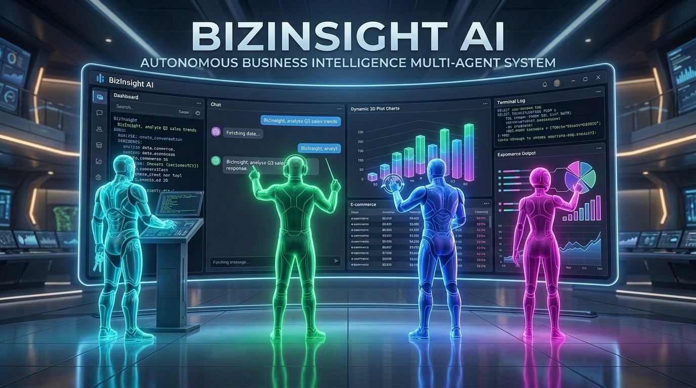
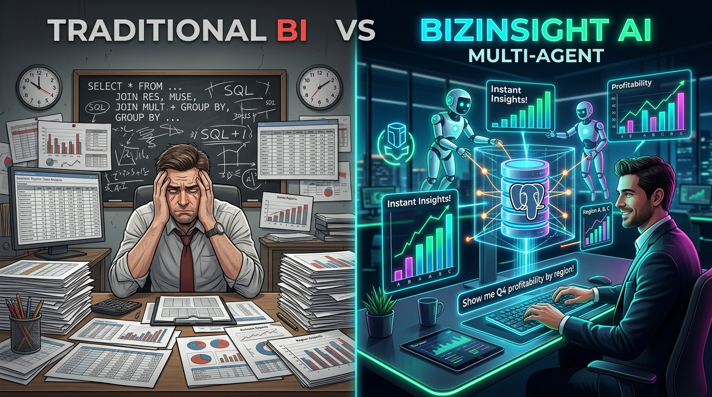
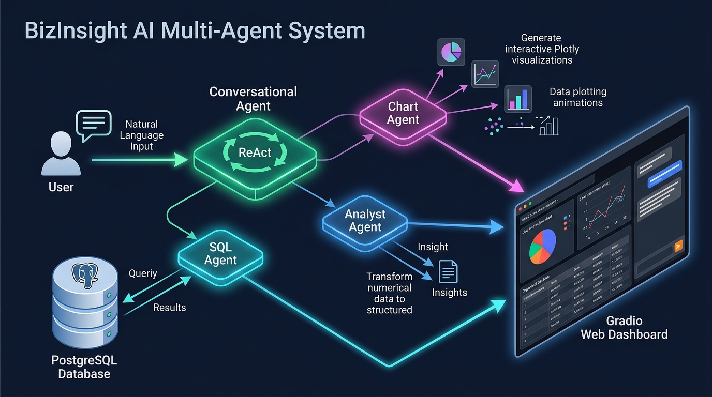
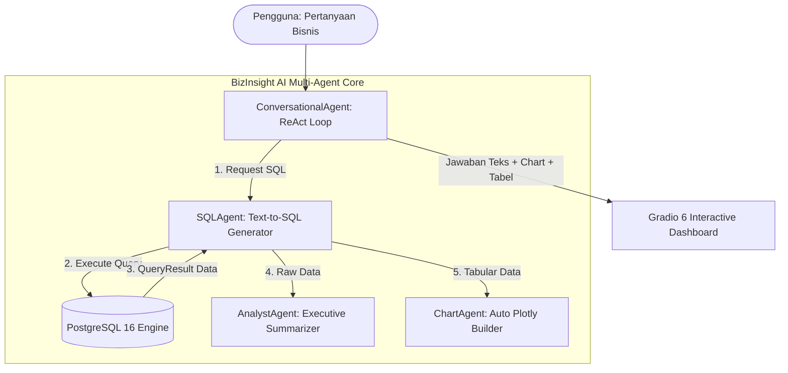
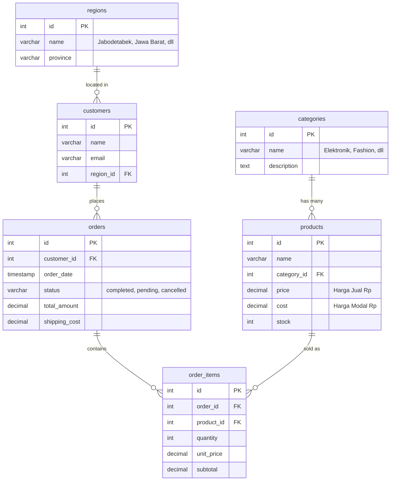

<div align="center">



# 🧠 BizInsight AI
### *Autonomous Business Intelligence Multi-Agent System*

[](https://www.python.org/)
[](https://fastapi.tiangolo.com/)
[](https://react.dev/)
[](https://www.typescriptlang.org/)
[](https://tailwindcss.com/)
[](https://www.postgresql.org/)
[](https://plotly.com/)
[](https://opensource.org/licenses/MIT)

<p align="center">
  <b>Natural Language ➔ Automated Text-to-SQL ➔ Safe Execution ➔ Business Synthesis ➔ Dynamic Plotly Visualizations</b>
</p>

*Membantu tim bisnis dan manajemen mengeksplorasi data e-commerce secara interaktif menggunakan bahasa natural tanpa perlu menulis SQL.*

</div>

---

## 📌 Daftar Isi
- [Tentang Proyek](#-tentang-proyek)
- [Fitur Utama](#-fitur-utama)
- [Arsitektur Multi-Agent](#-arsitektur-multi-agent)
- [Database Schema & ERD](#-database-schema--erd)
- [Sistem Keamanan & Guardrails](#-sistem-keamanan--guardrails)
- [Tampilan Antarmuka Dashboard](#-tampilan-antarmuka-dashboard)
- [Tech Stack](#-tech-stack)
- [Panduan Instalasi & Menjalankan](#-panduan-instalasi--menjalankan)
- [Contoh Pertanyaan Bisnis](#-contoh-pertanyaan-bisnis)
- [Struktur Direktori](#-struktur-direktori)
- [Lisensi](#-lisensi)

---

## 💡 Tentang Proyek

<div align="center">
  
</div>

**BizInsight AI** adalah platform Business Intelligence generasi baru yang didorong oleh arsitektur **Autonomous Multi-Agent**. Sistem ini dirancang untuk menjembatani kesenjangan antara tim bisnis (non-teknis) dengan database relasional (PostgreSQL). 

Pengguna cukup mengajukan pertanyaan dalam **Bahasa Indonesia** sehari-hari (misal: *"Berapa omset kategori Elektronik di kuartal pertama 2026?"*), dan agen-agen AI akan berkolaborasi untuk menyusun query SQL, memvalidasi keamanan transaksi, mengeksekusi data, merangkum wawasan komersial, serta menyajikan grafik interaktif secara otomatis.

---

## 🌟 Fitur Utama

- 🗣️ **Zero-Code Natural Language Queries**: Bertanya menggunakan bahasa Indonesia santai maupun formal tanpa menyentuh sintaks SQL.
- ⚡ **Self-Healing Text-to-SQL**: Jika query mengalami kegagalan pada percobaan pertama (misal: kesalahan relasi kolom), agen secara otomatis melakukan diagnosa error dan memperbaiki query tersebut secara mandiri.
- 🔄 **ReAct Tool Calling Loop**: Agen orkestrator bernalar secara dinamis (*Reasoning + Acting*) hingga 4 iterasi untuk memutuskan kapan harus membaca skema, query database, merangkum wawasan, atau membuat grafik.
- 📊 **Intelligent Chart Selection**: Plotly figure builder cerdas yang otomatis memilih visualisasi optimal (*Bar Chart, Line Chart, Pie/Donut Chart, atau Scatter Plot*) berdasarkan dimensi data.
- 💬 **Conversational Context & Memory**: Memahami pertanyaan lanjutan (*follow-up*) dalam satu sesi percakapan tanpa perlu mengulang konteks dari awal.
- 🖥️ **Live ANSI Agent Streaming**: Mengalirkan alur kerja internal setiap agen secara *real-time* ke terminal UI web dengan kode warna unik.
- 🛡️ **Enterprise Safety Guardrails**: Eksekusi terisolasi dalam mode *Read-Only*, penyaringan regex kata kunci destruktif, pembatasan kuota baris (*row-limits*), dan batas waktu *statement timeout*.

---

## 🏗️ Arsitektur Multi-Agent

<div align="center">
  
</div>

Sistem ini menerapkan pola arsitektur **Multi-Agent terdistribusi** di mana setiap agen memiliki spesialisasi dan tanggung jawab tunggal (*Single Responsibility Principle*):



### Spesifikasi Agen (The Specialized AI Squad):

<div align="center">
  
</div>
| Agen | Kode Warna Terminal | Peran & Tanggung Jawab |
| :--- | :--- | :--- |
| **`SQLAgent`** | `CYAN` | Menerjemahkan natural language ke SQL PostgreSQL, validasi sintaks, eksekusi database, dan *self-healing*. |
| **`AnalystAgent`** | `BLUE` | Menganalisis metrik komersial, menemukan pola anomali/tren, dan menyusun rekomendasi taktis. |
| **`ChartAgent`** | `MAGENTA` | Menentukan jenis grafik terbaik dan merender visualisasi interaktif Plotly modern. |
| **`ConversationalAgent`** | `GREEN` | Orkestrator ReAct tool-calling, manajemen histori sesi percakapan, dan sintesis jawaban akhir. |
| **`BIAgentFramework`** | `YELLOW` | Entry point tunggal aplikasi, lazy initialization memori, dan helper eksplorasi database. |

---

## 🗄️ Database Schema & ERD

Database dirancang menyerupai ekosistem e-commerce Indonesia modern dengan data transaksi historis tahun **2026**:



---

## 🛡️ Sistem Keamanan & Guardrails

| Layer Keamanan | Mekanisme Proteksi |
| :--- | :--- |
| **SQL Injection & Mutation** | Regex guard menolak mutasi (`INSERT`, `UPDATE`, `DELETE`, `DROP`, `ALTER`, `TRUNCATE`, `GRANT`). |
| **Session Isolation** | Koneksi PostgreSQL diset secara eksplisit ke mode `readonly = True`. |
| **Execution Timeout** | `SET statement_timeout = '10s'` mencegah query berat membebani server. |
| **Result Throttling** | Hasil eksekusi dibatasi maksimal `500` baris per transaksi untuk menjaga performa memori. |
| **Credential Safety** | API keys dan kredensial database diisolasi dalam file `.env` (diabaikan oleh git). |

---

## 🖥️ Tampilan Antarmuka Dashboard

Aplikasi dibangun menggunakan **Gradio 6 Blocks** dengan 3 tab interaktif:

1. **💬 Tab 1: AI Business Analyst**:
   - Area chat percakapan interaktif dengan respon cerdas.
   - Quick Action buttons untuk pertanyaan bisnis umum.
   - **Auto Chart Display**: Panel visualisasi Plotly interaktif.
   - **Data Table Panel**: Tabel hasil query SQL mentah.
   - **SQL Preview Accordion**: Transparansi query SQL yang di-generate AI.
2. **🖥️ Tab 2: Real-time Agent Log Stream**:
   - Terminal virtual *dark mode* menampilkan streaming aktivitas multi-agen secara live (*thread-safe QueueHandler*).
3. **📋 Tab 3: Database Explorer**:
   - Kartu statistik metrik bisnis (Total Produk, Pelanggan, Pesanan, Omset).
   - Penjelajah data tabel secara live & penampil DDL skema database.

---

## 🛠️ Tech Stack

### Backend
- **Core Engine**: Python 3.10+
- **API Framework**: FastAPI 0.115+ & Uvicorn (REST API + Server-Sent Events / SSE)
- **LLM Gateway**: [LiteLLM](https://github.com/BerriAI/litellm) (Google Gemini 3.6 Flash / Groq Llama & GPT-OSS)
- **Database Engine**: PostgreSQL 16 & `psycopg2-binary` (Threaded Connection Pool)
- **Data Validation**: Pydantic v2
- **Data Analytics & Viz**: Pandas & Plotly Express / Graph Objects

### Frontend
- **Framework**: React 19 + TypeScript (Vite 8)
- **Styling**: Tailwind CSS v4
- **Visualisasi**: Plotly.js (`plotly.js-dist-min`)
- **Icons & Markdown**: Lucide React & React-Markdown + Remark-GFM

---

## 🚀 Panduan Instalasi & Menjalankan

### 1. Kloning Repositori
```bash
git clone https://github.com/SejatiDimedia/bizinsight_ai_llm.git
cd bizinsight_ai_llm
```

### 2. Setup Virtual Environment
```bash
python3 -m venv venv
source venv/bin/activate
pip install --upgrade pip
pip install -r requirements.txt
```

### 3. Konfigurasi Environment Variable
Salin template konfigurasi dan masukkan API Key Anda:
```bash
cp .env.example .env
```
Edit file `.env`:
```ini
GEMINI_API_KEY=masukkan_api_key_gemini_anda
GROQ_API_KEY=masukkan_api_key_groq_anda
PRIMARY_MODEL=gemini/gemini-3.6-flash
FALLBACK_MODEL=groq/openai/gpt-oss-120b
```

### 4. Jalankan Database PostgreSQL (Docker)
```bash
docker compose up -d
```

### 5. Seeding Data Dummy Bisnis 2026
```bash
python seed_database.py
```

### 6. Jalankan Backend API (FastAPI)
Untuk melayani REST API & Real-time Log Streaming:
```bash
python api.py
# atau: uvicorn backend.main:app --reload --port 8000
```
- Akses API root di **`http://127.0.0.1:8000`**.
- Dokumentasi interaktif Swagger UI di **`http://127.0.0.1:8000/docs`**.

### 7. Jalankan Frontend UI (React + Vite)
Buka terminal terpisah dan jalankan frontend server:
```bash
cd frontend
npm install
npm run dev
```
- Akses dashboard React di **`http://localhost:5173`**.

*(Opsional) Jika ingin menjalankan dashboard monolitik Gradio versi terdahulu:*
```bash
python app.py
```
Akses di **`http://127.0.0.1:7860`**.

---

## 📊 Contoh Pertanyaan Bisnis

| Kategori Analisis | Contoh Pertanyaan Natural Language |
| :--- | :--- |
| **Agregasi Omset** | *"Berapa total pendapatan bisnis dari pesanan yang sukses di tahun 2026?"* |
| **Ranking & Performa** | *"Tampilkan 5 produk paling laris berdasarkan jumlah unit yang terjual beserta omsetnya."* |
| **Dinamika Musiman** | *"Bagaimana tren penjualan bulanan dari Januari hingga Agustus 2026?"* |
| **Analisis Regional** | *"Wilayah mana yang memberikan kontribusi omset tertinggi?"* |
| **Profitabilitas** | *"Produk apa saja yang memiliki margin keuntungan tertinggi?"* |
| **Follow-up Context** | *Tanya 1:* *"Kategori apa yang penjualannya tertinggi?"*<br>*Tanya 2:* *"Produk apa saja yang ada di kategori tersebut?"* |

---

## 📁 Struktur Direktori

```text
bizinsight_ai_llm/
├── .env.example              # Template variabel lingkungan
├── .gitignore                # Aturan isolasi file rahasia dan cache
├── docker-compose.yml        # Konfigurasi container PostgreSQL 16
├── requirements.txt          # Daftar pustaka Python backend
├── PRD.md                    # Product Requirement Document
├── README.md                 # Dokumentasi teknis proyek
│
├── backend/                  # Arsitektur Modular Backend FastAPI
│   ├── config.py             # Centralized settings & environment loader
│   ├── main.py               # FastAPI entrypoint, lifespan, CORS & routers
│   ├── api/
│   │   ├── schemas.py        # Pydantic v2 schemas (Chat, Sessions, Metrics, Database)
│   │   ├── logging_stream.py # SSE broadcaster queue untuk streaming log multi-agent
│   │   └── routers/          # Modular API routers: chat.py, metrics.py, database.py
│   ├── core/
│   │   └── framework.py      # BIAgentFramework core & session memory management
│   └── database/
│       └── connection.py     # ThreadedConnectionPool & query execution safety
│
├── frontend/                 # Modern React 19 + TypeScript + Tailwind CSS UI
│   ├── package.json          # Vite + React + Tailwind + Plotly dependencies
│   ├── vite.config.ts        # Vite build config & proxy ke FastAPI (8000)
│   └── src/
│       ├── types/api.ts      # TypeScript interfaces API contracts
│       ├── services/api.ts   # Client fetch & SSE streaming service
│       ├── components/
│       │   ├── Header.tsx           # KPI ticker & live DB status strip
│       │   ├── Sidebar.tsx          # Session management & new chat button
│       │   ├── ChatWindow.tsx       # Message list, quick prompts, Markdown render
│       │   ├── ArtifactViewer.tsx   # Interactive Plotly chart, SQL & raw table view
│       │   ├── PlotlyChart.tsx      # Responsive Plotly canvas renderer
│       │   ├── LogDrawer.tsx        # Live terminal ANSI agent log stream drawer
│       │   └── DbExplorerModal.tsx  # Interactive PostgreSQL table & DDL explorer
│       └── App.tsx           # Main application state & responsive layout
│
├── agents/                   # Modul agen cerdas
│   ├── agent.py              # BaseAgent superclass (ANSI color logging terstandarisasi)
│   ├── models.py             # Pydantic v2 data contracts (SQLQuery, QueryResult, ChartConfig)
│   ├── sql_agent.py          # SQLAgent: Text-to-SQL + PostgreSQL executor + self-healing
│   ├── analyst_agent.py      # AnalystAgent: Business insights & tactical advice summarizer
│   ├── chart_agent.py        # ChartAgent: Auto-visualization selector & Plotly figure builder
│   └── conversational_agent.py # ConversationalAgent: ReAct tool calling loop & chat memory
│
├── api.py                    # Backward-compatible proxy to backend.main:app
├── db.py                     # Backward-compatible proxy to backend.database.connection
├── bi_agent_framework.py     # Backward-compatible proxy to backend.core.framework
├── app.py                    # Web Dashboard alternatif (Gradio 6 + Plotly)
└── seed_database.py          # Script pembuat DDL & generator data dummy e-commerce 2026
```

---

## 📄 Lisensi

Didistribusikan di bawah Lisensi **MIT**. Lihat `LICENSE` untuk informasi lebih lanjut.

<div align="center">
  <sub>Dikembangkan dengan ❤️ oleh <b><a href="https://github.com/SejatiDimedia">SejatiDimedia</a></b></sub>
</div>